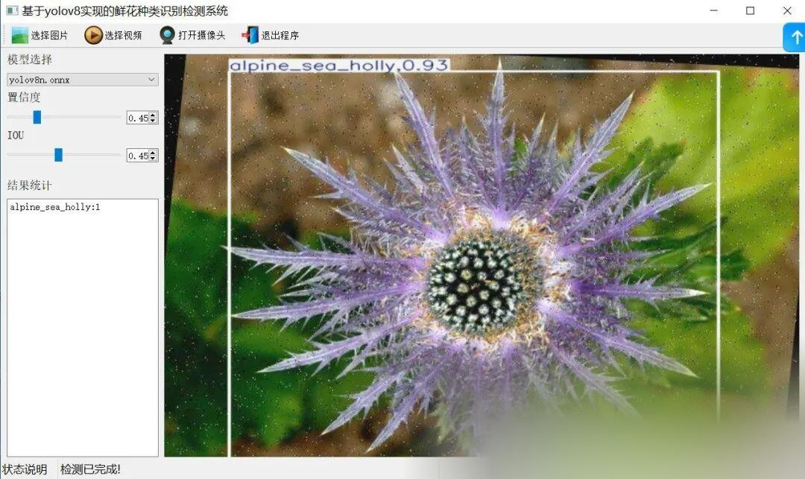
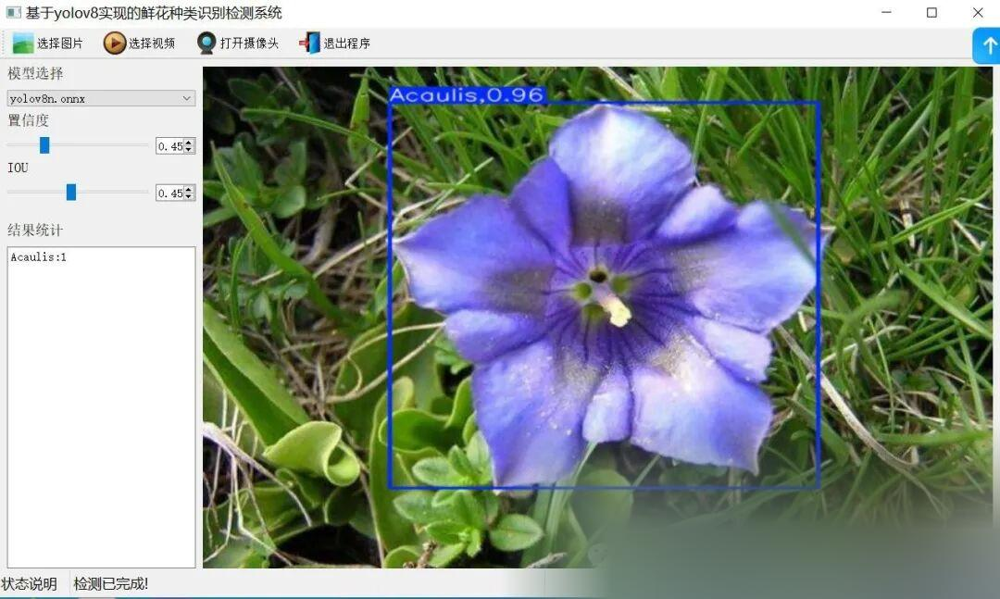

# 106 Flower Recognition System Based on Yolov8 with Python Source Code, ONNX Model, Evaluation Indicator Curve, and High-quality GUI Interface

[Algorithm Introduction]The 106 flower identification and detection system based on YOLOv8 is an innovative application that integrates advanced deep learning technology.

[Algorithm Introduction]

The 106 flower recognition and detection system based on YOLOv8 is an innovative application that integrates advanced deep learning technology. This system utilizes the YOLOv8 algorithm, one of the most advanced target detection models currently available, to achieve rapid and accurate identification of 106 different types of flowers.

YOLOv8 showcases outstanding performance in the task of flower recognition with its fast speed, high accuracy, and robustness. The system ensures efficient feature extraction and accurate classification of various flower characteristics by constructing a dataset containing diverse images of flowers and employing an efficient network structure and optimization strategies for model training.

In practical applications, the system can rapidly identify and label the types of flowers in images, providing location information and confidence scores. This provides users with an intuitive and convenient identification experience. Whether it is for plant enthusiasts, gardeners, or researchers, they can easily achieve automatic flower recognition and classification through this system, thereby enhancing work efficiency and accuracy.

Furthermore, the system also supports real-time detection capabilities, which can identify flowers in video streams or live camera footage in real time, further expanding its application scenarios and practical value. In the future, with the continuous development and optimization of technology, the flower recognition and flower detection system based on YOLOv8 will play an important role in more fields, providing strong support for the protection of flowers and landscaping design.

[Effect Display]





[Test Environment]

windows10
anaconda3+python3.8
torch==1.9.0+cu111
ultralytics==8.2.70

The model can detect the category.

["Acaulis","Alstroemeria","Artichoke","Bommaji","Calla","Carnation","Chamnahree","Cosmos","Curcuma","Dalnancho","Dandelion","Dongja","Doraji","Echinacea","Englishdaisy","FranceGukhwa","Fritillaria","Geuknakjo","Geumeocho","Geumggyeguk","Geumjanhwa","Geummaehwa","GgangGgangyee","Gloriosa","Guemgangchorong","Gyeongyeopduran","Halmi","Jjille","Lentenrose","Marigold","Minariajaebi","Mugunghwa","Mulmangcho","Muskari","Nigella","NorangGgotchangpo","Norugwi","Poinsettia","Suseonhwa","Suyeompaeraengi","Sweetpea","Yongwang","alpine_sea_holly","anthurium","azalea","ball_moss","barbeton_daisy","bearded_iris","bee_balm","bishop_of_llandaff","black_eyed_susan","blackberry_lily","blanket_flower","bolero_deep_blue","bougainvillea","bromelia","californian_poppy","camellia","canna_lily","canterbury_bells","cape_flower","cautleya_spicata","clematis","columbine","common_dandelion","corn_poppy","cyclamen","desert-rose","foxglove","frangipani","garden_phlox","gaura","gazania","geranium","globe_thistle","great_masterwort","hibiscus","hippeastrum","japanese_anemone","lotus","magnolia","mallow","mexican_petunia","monkshood","morning_glory","orange_dahlia","osteospermum","passion_flower","petunia","pincushion_flower","pink-yellow_dahlia","pink_primrose","primula","prince_of_wales_feathers","red_ginger","rose","ruby-lipped_cattleya","silverbush","spear_thistle","spring_crocus","sunflower","sword_lily","thorn_apple","toad_lily","tree_mallow","water_lily"]

[Training Information]

| Parameter | Value |
| ----------- | -------- |
| Training set images count | 18162 |
| Validation set images count | 1730 |
| Training map | 91.0% |
| Training precision (Precision) | 87.3% |
| Training recall rate (Recall) | 87.6% |

[Training dataset (Dataset may have optimization potential and differ from the number of models trained)]

https://blog.csdn.net/FL1623863129/article/details/141872927

[Partial Implementation Source Code]

-
-
-
-
-
-
-
-
-
-
-
-
-
-
-
-
-
-
-
-
-
-
-
-
-
-
-
-
-
-
-
-
-
-
-
-
-
-
-
-
-
-
-
-
-
-
-
-
-
-
-
-
-
-
-
-
-
-
-
-
-
-
-
-
-
-
-
-
-
-
-
-
-
-
-
-
-
-
-
-
-
-
-
-
-
-
-
-
-
-
-
-
-
-
-
-
-
-
-
-
-
-
-
-
-
-
-
-

```
class Ui_MainWindow(QtWidgets.QMainWindow):    signal = QtCore.pyqtSignal(str, str)     def setupUi(self):        self.setObjectName("MainWindow")        self.resize(1280, 728)        self.centralwidget = QtWidgets.QWidget(self)        self.centralwidget.setObjectName("centralwidget")         self.weights_dir = './weights'         self.picture = QtWidgets.QLabel(self.centralwidget)        self.picture.setGeometry(QtCore.QRect(260, 10, 1010, 630))        self.picture.setStyleSheet("background:black")        self.picture.setObjectName("picture")        self.picture.setScaledContents(True)        self.label_2 = QtWidgets.QLabel(self.centralwidget)        self.label_2.setGeometry(QtCore.QRect(10, 10, 81, 21))        self.label_2.setObjectName("label_2")        self.cb_weights = QtWidgets.QComboBox(self.centralwidget)        self.cb_weights.setGeometry(QtCore.QRect(10, 40, 241, 21))        self.cb_weights.setObjectName("cb_weights")        self.cb_weights.currentIndexChanged.connect(self.cb_weights_changed)         self.label_3 = QtWidgets.QLabel(self.centralwidget)        self.label_3.setGeometry(QtCore.QRect(10, 70, 72, 21))        self.label_3.setObjectName("label_3")        self.hs_conf = QtWidgets.QSlider(self.centralwidget)        self.hs_conf.setGeometry(QtCore.QRect(10, 100, 181, 22))        self.hs_conf.setProperty("value", 25)        self.hs_conf.setOrientation(QtCore.Qt.Horizontal)        self.hs_conf.setObjectName("hs_conf")        self.hs_conf.valueChanged.connect(self.conf_change)        self.dsb_conf = QtWidgets.QDoubleSpinBox(self.centralwidget)        self.dsb_conf.setGeometry(QtCore.QRect(200, 100, 51, 22))        self.dsb_conf.setMaximum(1.0)        self.dsb_conf.setSingleStep(0.01)        self.dsb_conf.setProperty("value", 0.25)        self.dsb_conf.setObjectName("dsb_conf")        self.dsb_conf.valueChanged.connect(self.dsb_conf_change)        self.dsb_iou = QtWidgets.QDoubleSpinBox(self.centralwidget)        self.dsb_iou.setGeometry(QtCore.QRect(200, 160, 51, 22))        self.dsb_iou.setMaximum(1.0)        self.dsb_iou.setSingleStep(0.01)        self.dsb_iou.setProperty("value", 0.45)        self.dsb_iou.setObjectName("dsb_iou")        self.dsb_iou.valueChanged.connect(self.dsb_iou_change)        self.hs_iou = QtWidgets.QSlider(self.centralwidget)        self.hs_iou.setGeometry(QtCore.QRect(10, 160, 181, 22))        self.hs_iou.setProperty("value", 45)        self.hs_iou.setOrientation(QtCore.Qt.Horizontal)        self.hs_iou.setObjectName("hs_iou")        self.hs_iou.valueChanged.connect(self.iou_change)        self.label_4 = QtWidgets.QLabel(self.centralwidget)        self.label_4.setGeometry(QtCore.QRect(10, 130, 72, 21))        self.label_4.setObjectName("label_4")        self.label_5 = QtWidgets.QLabel(self.centralwidget)        self.label_5.setGeometry(QtCore.QRect(10, 210, 72, 21))        self.label_5.setObjectName("label_5")        self.le_res = QtWidgets.QTextEdit(self.centralwidget)        self.le_res.setGeometry(QtCore.QRect(10, 240, 241, 400))        self.le_res.setObjectName("le_res")        self.setCentralWidget(self.centralwidget)        self.menubar = QtWidgets.QMenuBar(self)        self.menubar.setGeometry(QtCore.QRect(0, 0, 1110, 30))        self.menubar.setObjectName("menubar")        self.setMenuBar(self.menubar)        self.statusbar = QtWidgets.QStatusBar(self)        self.statusbar.setObjectName("statusbar")        self.setStatusBar(self.statusbar)        self.toolBar = QtWidgets.QToolBar(self)        self.toolBar.setToolButtonStyle(QtCore.Qt.ToolButtonTextBesideIcon)        self.toolBar.setObjectName("toolBar")        self.addToolBar(QtCore.Qt.TopToolBarArea, self.toolBar)        self.actionopenpic = QtWidgets.QAction(self)        icon = QtGui.QIcon()        icon.addPixmap(QtGui.QPixmap(":/images/1.png"), QtGui.QIcon.Normal, QtGui.QIcon.Off)        self.actionopenpic.setIcon(icon)        self.actionopenpic.setObjectName("actionopenpic")        self.actionopenpic.triggered.connect(self.open_image)        self.action = QtWidgets.QAction(self)        icon1 = QtGui.QIcon()        icon1.addPixmap(QtGui.QPixmap(":/images/2.png"), QtGui.QIcon.Normal, QtGui.QIcon.Off)        self.action.setIcon(icon1)        self.action.setObjectName("action")        self.action.triggered.connect(self.open_video)        self.action_2 = QtWidgets.QAction(self)        icon2 = QtGui.QIcon()        icon2.addPixmap(QtGui.QPixmap(":/images/3.png"), QtGui.QIcon.Normal, QtGui.QIcon.Off)        self.action_2.setIcon(icon2)        self.action_2.setObjectName("action_2")        self.action_2.triggered.connect(self.open_camera)         self.actionexit = QtWidgets.QAction(self)        icon3 = QtGui.QIcon()        icon3.addPixmap(QtGui.QPixmap(":/images/4.png"), QtGui.QIcon.Normal, QtGui.QIcon.Off)        self.actionexit.setIcon(icon3)        self.actionexit.setObjectName("actionexit")        self.actionexit.triggered.connect(self.exit)         self.toolBar.addAction(self.actionopenpic)        self.toolBar.addAction(self.action)        self.toolBar.addAction(self.action_2)        self.toolBar.addAction(self.actionexit)         self.retranslateUi()        QtCore.QMetaObject.connectSlotsByName(self)        self.init_all()
```

[Usage Steps]

Usage Steps:
1. First, install the YOLOv8 environment according to the official framework https://github.com/ultralytics/ultralytics and PyQt5 installation tutorial.
2. After switching to your installed YOLOv8 environment, navigate to the source code directory and execute python main.py to start the interface for operation.

[Provided Files]

Python source code
YOLOv8n.onnx model (without PyTorch model)
Training map, P, R curves (in weights\results.png)
Test images (under test_img folder)


## Payment

Here is a pay link on Stripe ( https://buy.stripe.com/3cs8yP7sY87d0vu9AB ). Please contact me lonlonago@foxmail.com after funding $89, and I will send you a complete data files , thank you!


